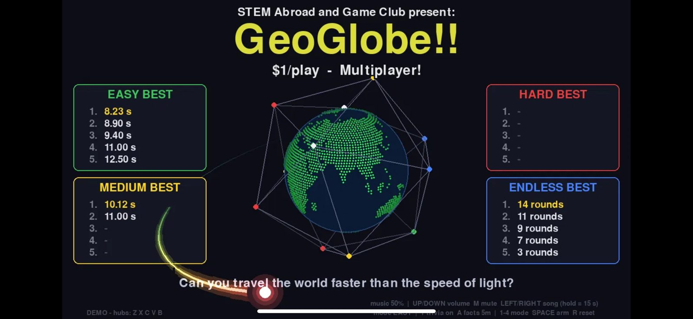
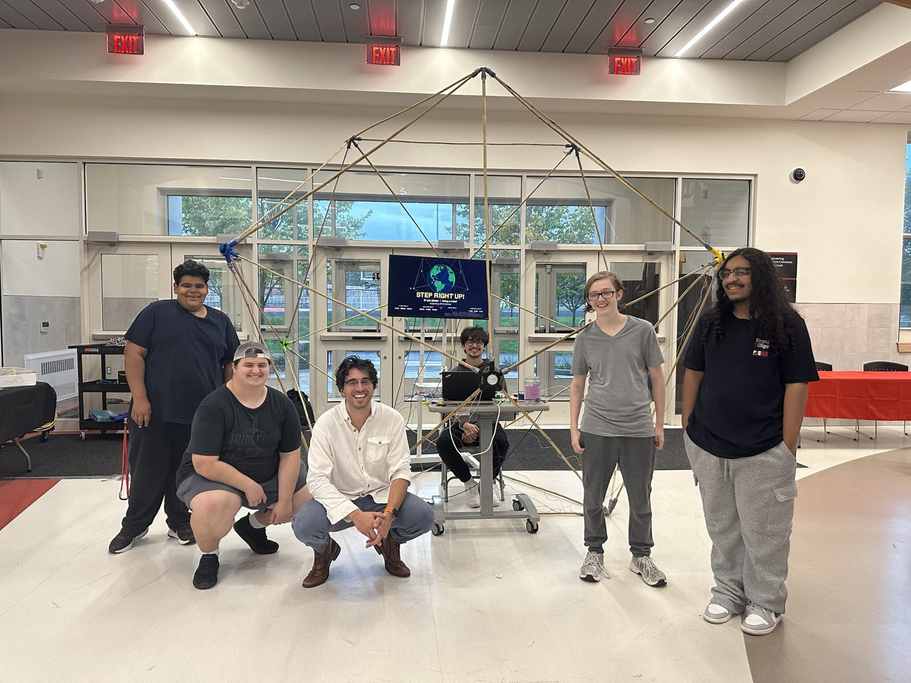
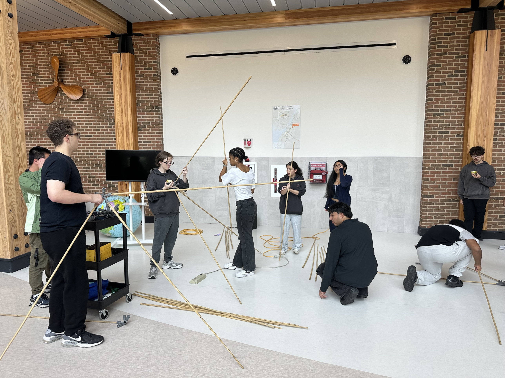
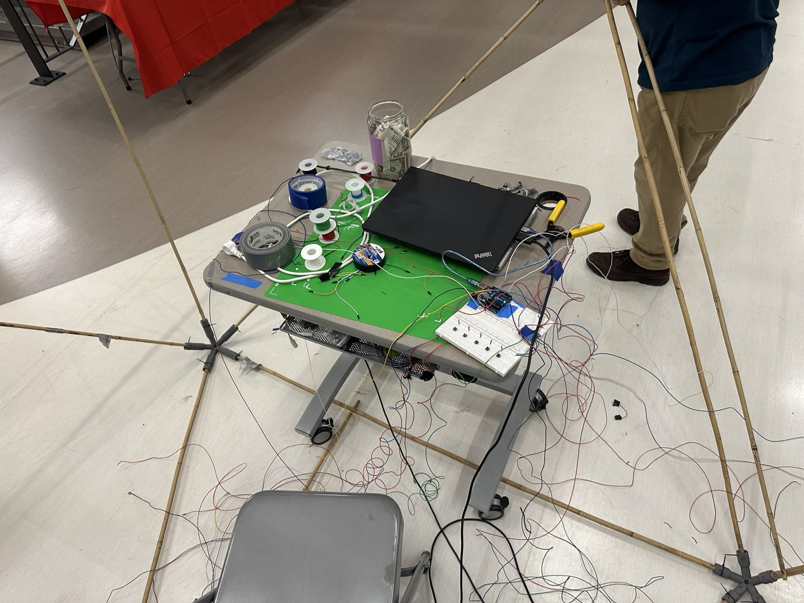
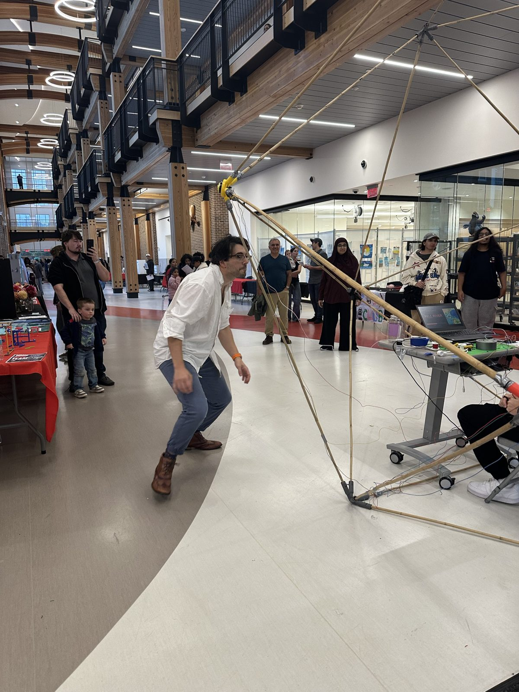

<!--
FRONT MATTER (between the --- lines above):
  title:    the project name
  summary:  the short text on the Past Projects card
  year:     shown on the card; cards are sorted by it, newest first
  image:    the card photo

This folder is a "page bundle": index.md is the page, and the photos in the same folder belong
to it. A photo is shown with: 
The text comes from the project's README on GitHub (github.com/coolguyalex/geoglobe).
-->

GeoGlobe is a walk-up arcade game built into a 10-foot sculpture. Teams run around a bamboo icosahedron hitting glowing arcade buttons in order before the timer runs out. Each button is a place the STEM Abroad club has travelled, or hopes to, and every run is a round trip that starts and ends at home in Fall River.

It was built for the Durfee High School open house as a $1-a-play fundraiser for STEM Abroad, by the STEM Abroad club and Game Club.

The full code, wiring and design notes are on GitHub: [coolguyalex/geoglobe](https://github.com/coolguyalex/geoglobe).

## How it works

- **The sculpture.** An icosahedron made of 6-foot bamboo poles and 3D-printed hubs, resting on one face. A zig-zag ring of edges, about 36 feet long, circles the middle.
- **The buttons.** Five illuminated 12 V arcade buttons sit on five of the ring's corners, all facing outward. Each one is a place: Fall River, Costa Rica, the Galápagos, Belize and the Amazon.
- **The Arduino.** An Arduino Uno owns the game. It does all the timing, reads the buttons, lights their LEDs and reports every event over USB.
- **The laptop and TV.** A Python program using pygame draws the screens and map, plays the tones, voice callouts and music, and keeps the leaderboard.
- **The globe.** A 36-inch inflatable globe hangs in the centre.

The main design rule is that the Arduino owns the game and the laptop owns the show. If the laptop stalls, it can never cause an unfair loss.

## Game modes

| Mode | Time per press | Presses | Route |
|---|---|---|---|
| Easy | 5 s | 6 | A fixed tour: Fall River, Costa Rica, Galápagos, Belize, Amazon, home |
| Medium | 3 s | 8 | Starts and ends at home, with a shuffled middle |
| Hard | 2 s | 10 | Starts at home, then fully random |
| Endless | 2 s, shrinking by 0.1 s each round | 10, plus one per round | Hard, round after round, until the first mistake |

A wrong button or a late press ends the run. The top five times in each mode are saved on a leaderboard.

## Building it

The sculpture was assembled by the team on the day: bamboo poles pushed into 3D-printed hubs, then wired up with the five buttons.

The control table sits inside the frame. It holds the Arduino, a breadboard and a laptop, with a lot of wire running out to the buttons.

## At the open house

## What to read next

- [The GeoGlobe repository](https://github.com/coolguyalex/geoglobe) has the Arduino sketch, the game code, and notes on the hardware, the serial protocol, the audio and why each design decision was made.
- To try the game with no hardware, the README explains how to run it in demo mode on a laptop.
